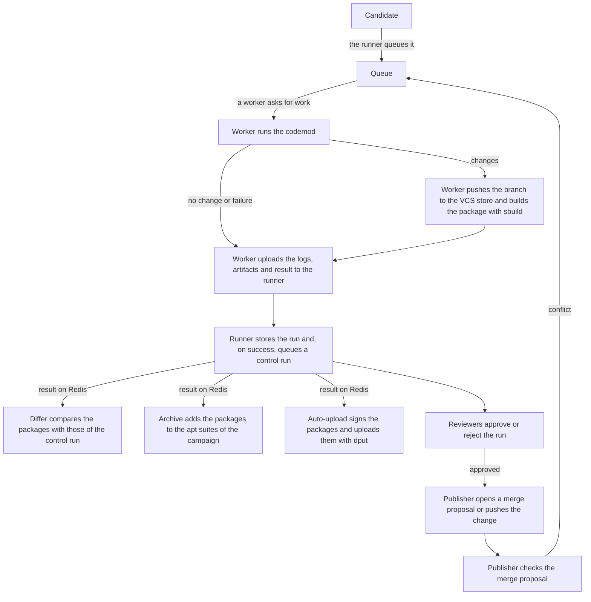

# Debian

## The apt archive

`janitor-archive` publishes the packages that runs build as apt repositories.
Each `apt_repository` block in `janitor.conf` becomes a suite of the same name.
It holds the highest version of each source package built for each
campaign in its `select` blocks, with the components of its `base`
distribution. Rejected runs are left out. A suite is generated again when a
Debian build in one of its campaigns succeeds, and every 12 hours.

The archive also makes suites on request, for one run (`dists/run/<run-id>`),
for a change set (`dists/cs/<change-set>`) and for the latest change set of a
codebase in a campaign (`dists/<campaign>/<codebase>`).

Workers build against the suites in the campaign's `extra_build_distribution`
and, if the run is part of a change set, that change set's suite. The runner
passes these to them as apt sources under its `--public-apt-archive-location`,
marked `trusted=yes`.

The archive does not serve the packages, only the indexes under `dists/`.
Packages point at `<campaign>/pkg/<package>/<run-id>/<file>`, which the site
serves from the artifact store. So serve both under one URL, with `dists/`
going to the archive.

## The signing key

The archive signs each `Release` file with `gpg`, writing `InRelease` and
`Release.gpg`. It uses the default secret key in the keyring of the user it
runs as, or the key given with `--gpg-key-id`.

The site, when started with `--archiver-url`, gets the public key from the
archive and serves it to users as `/archive-keyring.asc` and
`/archive-keyring.gpg`.

## Result codes and failure stages

Every run ends with a result code. [The overview](../devnotes/overview.md)
says what `success`, `nothing-to-do`, `nothing-new-to-do` and transient
failures mean.

A failed run usually also has a stage, which says where it stopped. It is a
path such as `codemod`, `build/build`, `build/apt-get-update` or
`build/lintian`.

The code comes from whichever part stopped the run:

- The worker has its own codes for the codemod stage, such as
  `command-failed`, and a codemod can report a code of its own.
- When a Debian build fails, ognibuild reads the sbuild log with
  buildlog-consultant and names the problem, such as
  `unsatisfied-apt-dependencies`.
- The runner sets codes such as `worker-timeout` when a worker times out or
  goes away.

`/cupboard/result-codes/` and `/cupboard/failure-stages/` count the latest run
of each codebase and campaign by code and by stage, leaving out transient
failures unless asked. The page of a run explains its code when
`py/janitor/site/templates/result-codes/` has a page for it.

## The lifetime of a run

This is how one run of a Debian campaign moves through the janitor.

