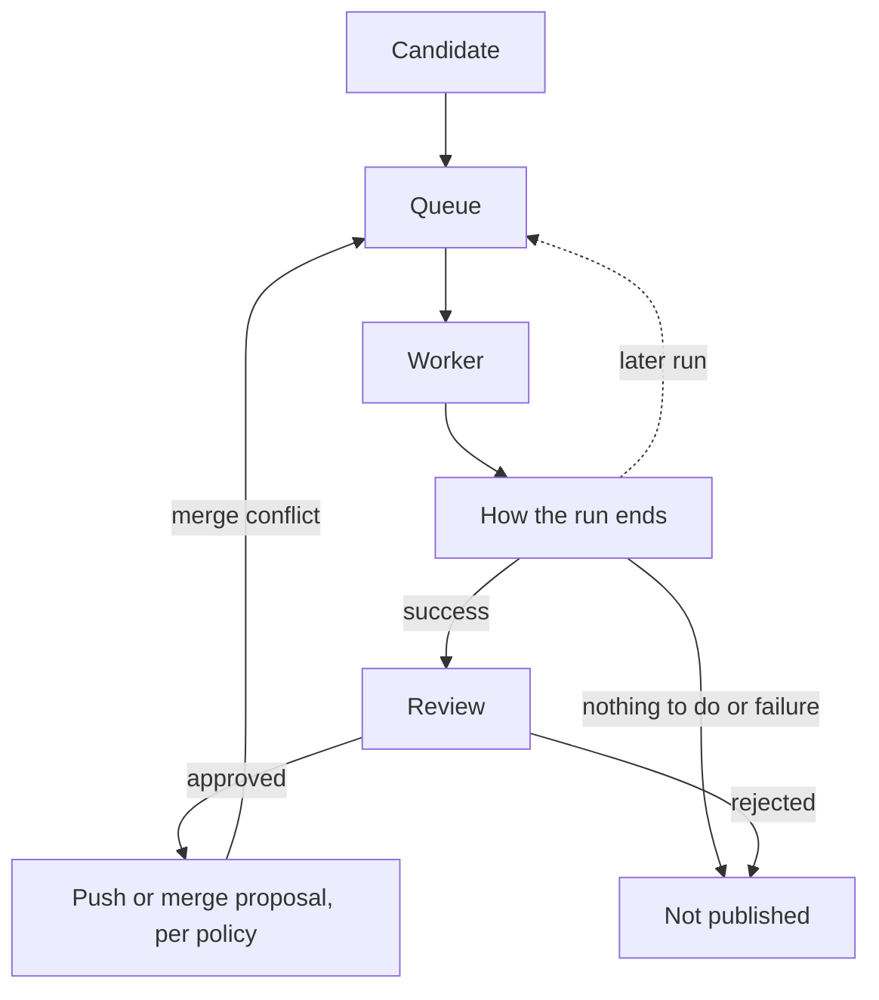

# What a run goes through

A run is one attempt at applying a codemod to one codebase. A codemod is
the command that makes a campaign's change. A run starts from a candidate
in the queue and goes to a worker. A successful run can then be reviewed
and published:

## Queue

The runner puts each candidate in the queue, as
[scheduling.md](scheduling.md) describes, and hands the next one to a
worker that asks for work. After each run, the candidate goes back in the
queue for a later run. A successful run also queues a control run: the
same codebase built without the change, so the two builds can be compared.

## Stages

For each run, the worker goes through these stages, in order:

1. `setup`: the codebase is fetched, the right branch is checked out and
   the working tree is set up.
2. `validate`: the worker checks the codebase before changing it, for
   example that it is a Debian package when the campaign builds Debian
   packages.
3. `codemod`: the codemod runs and makes the change.
4. `result-push`: the changed branches are pushed to the VCS store, so the
   change is kept even if the build fails.
5. `build`: the changed codebase is built.
6. `test`: for a campaign with a `generic` [target](glossary.md), the
   tests run. For a Debian package, tests run as part of `build`.

After that, the branches are stored again as the campaign's latest result.
The worker then uploads its logs and the result to the runner, whether the
run succeeded or not.

## How a run ends

A run ends in one of these ways, and its result code says which:

- `success`: the codemod made a change, and the change built.
- `nothing-to-do`: the codemod found nothing to change.
- `nothing-new-to-do`: the run made no changes beyond an earlier
  successful run.
- any other code: the run failed, and the code says why, such as
  `command-failed` when the codemod exits with an error.

Only a successful run can be reviewed and published. Otherwise, the
candidate still goes back in the queue, but the runner estimates its chance
of success from its earlier runs, so a candidate that keeps failing or
finding nothing to do comes up later. Some failures, such as a failed DNS
lookup, are transient: they do not count in that estimate, and a later run
may succeed.

`/cupboard/result-codes/` shows runs by result code, and each code links
to a list of its runs. Candidates without a run so far count as
`never-processed`. `/cupboard/failure-stages/` shows failed runs by
stage. Both count the latest run of each current candidate. Tick "Include
historical" to add codebases that are no longer candidates, and "Include
transient" for transient failures.

## Review and publishing

A QA reviewer approves or rejects a successful run on the run's page or
on the `/cupboard/review` page.

Once a run is approved, the publisher pushes the change or opens a merge
proposal, as the candidate's publish policy says.
With a `build-only` or `skip` publish mode, or with no
policy, the run is not published. If a merge proposal later has a merge
conflict, the publisher triggers a rerun of the candidate.
