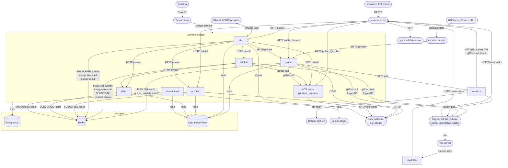

# Service Map

How the Janitor services talk to each other, to storage and to the outside
world. See also [how work flows](flow.md), the [glossary](glossary.md) and
the [production setup](production.md).

Square boxes are Janitor programs, rounded boxes are other software,
cylinders are storage. Public ports sit behind the reverse proxy; private
ports serve the other services and Prometheus. Workers log in to the runner
and the VCS stores with HTTP Basic Auth, checked against the `worker` table.

| Service or store | Ports (public / private) | Talks to | Protocol | Config key or flag |
|---|---|---|---|---|
| site | 8090 / 8080 | runner, publish, differ, archive, VCS stores, OAuth2 / OIDC provider | HTTP, OAuth2 | `oauth2_provider`, `--runner-url`, `--publisher-url`, `--differ-url`, `--archiver-url` |
| runner | 9919 / 9911 | VCS stores, workers, forges | HTTP, git/bzr, forge API | `--public-vcs-location`, `--public-apt-archive-location`, `--public-dep-server-url` |
| publish | - / 9912 | differ, VCS stores, forges | HTTP, git/bzr, forge API | `--differ-url`, `--external-url` |
| archive | 9914 (one port) | - | HTTP | `--dists-directory` |
| differ | - / 9920 | - | HTTP | `--cache-path` |
| git-store, bzr-store | git 9924 / 9923, bzr 9930 / 9929 | - | git or bzr over HTTP | `git_location`, `bzr_location`, `--vcs-path` |
| auto-upload | - / 9933 | upload target | dput | `--dput-host` |
| ognibuild dep server | 9934 (one port) | - | HTTP | the runner's `--public-dep-server-url` |
| mail filter | - | site (`/api/refresh-proposal-status`), which asks publish | HTTP | `--refresh-url` |
| workers | - / 9821 | runner, VCS stores, apt repository (archive, site), dep server, forges, Debian archive | HTTP(S), git/bzr, apt | `--base-url`, `--credentials` |
| PostgreSQL | - | used by every service in "Janitor services"; auto-upload only with `--backfill` | SQL | `database_location` |
| Redis | - | used by site, runner, publish, archive, differ, auto-upload | pub/sub; runner and publish also keep keys | `redis_location` |
| logs and artifacts | - | runner writes; site reads; archive, differ and auto-upload read artifacts | files or `gs://`; S3 for logs | `logs_location`, `artifact_location` |
| Prometheus, trace collector | - | scrapes `/metrics`; gets spans from runner, archive, git-store (OTLP) and site (Zipkin) | HTTP | `zipkin_address` (traces) |
